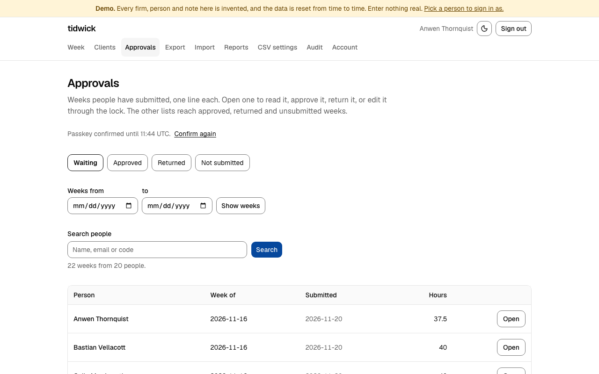
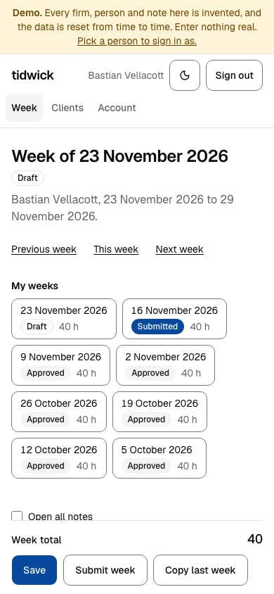

# tidwick

Weekly timesheet for professional-services firms on Cloudflare Workers, D1 and R2. AGPL-3.0 reference implementation: a technical person deploys it into the firm's own Cloudflare account; nobody hosts it. Version 0, author-tested only.

**Try it: [demo.tidwick.dev/demo](https://demo.tidwick.dev/demo).** Pick one of four invented people; the data is reset every night.

 

Week grid, clients and projects, three roles, submit/approve/lock, audit log, CSV export and import, passkey login and optional single sign-on (OpenID Connect), per-client note encryption, nightly encrypted off-account backup.

## Agents (MCP)

Off unless the operator sets `MCP=on`. A person makes a token on their account page, or approves an app, and an agent can then read and fill in that person's own weeks as a member would, over `/mcp`: seven tools, nothing that approves, exports or administers.
The only client checked is Claude Code, against a local instance over loopback. No hosted client has been checked yet.
Read the threat model in `docs/adr/0014-agent-surface.md` before turning it on; the demo leaves it off.

## Never

- A hosted service, multi-tenant mode, signup or billing.
- A migration tool beyond a CSV import of the adopter's own export; no API importers.
- Anything but Cloudflare (Workers, D1, R2, Cron, send-email, rate limits).
- A timer, calendar view, invoicing, rates or native apps.
- A support commitment.
- Copying another product's assets, text or look.
- Real data, secrets or a Cloudflare login in tests.

## Before you deploy

The button gets you a running Worker; a firm's instance needs more, and the nightly backup fails until it is done.

- A Cloudflare account on the Workers Paid plan, and a second Cloudflare account for the off-account backup copy.
- A domain on that account, for passkeys and for the alert mail (Email Routing, with the alert address verified).
- Someone who owns the offline kit (age identity, `NOTE_KEK`, `SESSION_SECRET`). Losing `NOTE_KEK` loses every note.
- About an hour, and a terminal for the backup bucket and its secrets.

## Deploy

The button ends at a Worker that answers `/setup`. The steps after it, from the first admin to the first backup, are in `docs/ARCHITECTURE.md`, Deploy.

## Run

`mise install; eval "$(mise env)"; just install; just check; just seed; just dev` (no Cloudflare account needed), then `just dev-session <who>` prints a Cookie header that signs you in as a seeded person, with no passkey. `just demo-local` serves the demo's data and personas at `localhost:4321/demo`.

Design: `docs/ARCHITECTURE.md`, decisions: `docs/adr/`. Deploy: Deploy section there.
Security: report vulnerabilities privately through the repository's security advisory form; no support commitment. No claim is made that the software is flaw-free.
Issues and discussions: github.com/tidwick/tidwick. `main` is the last release; pull requests go to `next`, which the demo at demo.tidwick.dev runs.
AGPL-3.0 (`LICENSE`), DCO sign-off (`git commit -s`), see `CONTRIBUTING.md`. Independent project, unaffiliated with and derived from no commercial time-tracking product; none of its code, assets or text was consulted.
