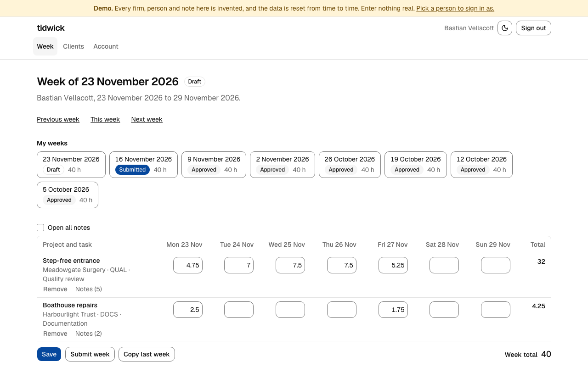

# tidwick

A weekly timesheet for a professional-services firm. It runs on Cloudflare Workers, D1 and R2, in the firm's own Cloudflare account. A technical person deploys it; nobody hosts it for you. AGPL-3.0 reference implementation, version 0, tested only by its author.

**Try it: [demo.tidwick.dev/demo](https://demo.tidwick.dev/demo).** Pick one of four invented people; there is no sign-up and no passkey. Start as a member: enter a week and submit it. Then be the accounting admin and approve it. The data is reset every night.

 

What is in it: the week grid, clients and projects, three roles, submit, approve and lock, an audit log, CSV export and import, passkey sign-in with optional single sign-on (OpenID Connect), notes encrypted per client, and a nightly encrypted backup to a second account.

## Agents (MCP)

Off unless the operator sets `MCP=on`; the demo leaves it off. A person makes a token on their account page, or approves an app. An agent can then read and fill in that person's own weeks over `/mcp`, as a member would. There are seven tools, and none approves, exports or administers.
Only Claude Code has been checked, against a local instance over loopback. No hosted client has been checked yet.
Read the threat model in `docs/adr/0014-agent-surface.md` before turning it on.

## Never

- A hosted service, multi-tenant mode, signup or billing.
- A migration tool beyond a CSV import of the adopter's own export; no API importers.
- Anything but Cloudflare (Workers, D1, R2, Cron, send-email, rate limits).
- A timer, calendar view, invoicing, rates or native apps.
- A support commitment.
- Copying another product's assets, text or look.
- Real data, secrets or a Cloudflare login in tests.

## Before you deploy

The button gives you a running Worker. A firm's instance needs more, and the nightly backup fails until you have:

- A Cloudflare account (plan: ARCHITECTURE §9), and a second one for the off-account backup copy.
- A domain on the first account, for passkeys and for alert mail (Email Routing, with the alert address verified).
- Someone who owns the offline kit (age identity, `NOTE_KEK`, `SESSION_SECRET`). Losing `NOTE_KEK` loses every note.
- About an hour, and a terminal for the backup bucket and its secrets.

## Deploy

The button ends at a Worker that answers `/setup`. It is untested on a real account. The steps after it, from the first admin to the first backup, are in `docs/ARCHITECTURE.md`, Deploy.

## Run

No Cloudflare account is needed: `mise install; eval "$(mise env)"; just install; just check; just seed; just dev`. Then `just dev-session <who>` prints a Cookie header that signs you in as a seeded person, with no passkey. `just demo-local` serves the demo's data and personas at `localhost:4321/demo`.

- Design and deploy: `docs/ARCHITECTURE.md`. Decisions: `docs/adr/`.
- Security: report a vulnerability privately (`SECURITY.md`). Nothing here claims the software is free of flaws.
- Contributing: `CONTRIBUTING.md`. `main` is the last release; pull requests go to `next`, which the demo runs.
- Licence: AGPL-3.0 (`LICENSE`). Independent of every commercial time-tracking product: none of their code, assets or text was consulted.
