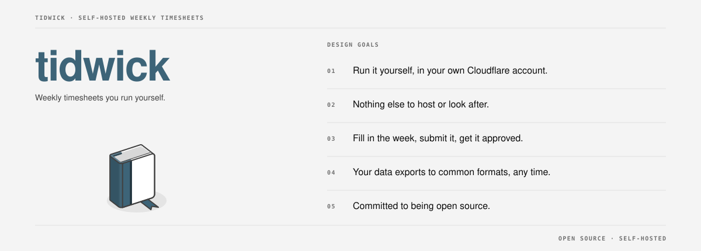

# tidwick

Weekly timesheet for professional-services firms on Cloudflare Workers, D1 and R2. AGPL-3.0 reference implementation: a technical person deploys it into the firm's own Cloudflare account; nobody hosts it. Version 0, author-tested only.

Week grid, clients and projects, three roles, submit/approve/lock, audit log, CSV export and import, passkey login and optional single sign-on (OpenID Connect), per-client note encryption, nightly encrypted off-account backup.

## Never

- A hosted service, multi-tenant mode, signup or billing.
- A migration tool beyond a CSV import of the adopter's own export; no API importers.
- Anything but Cloudflare (Workers, D1, R2, Cron, send-email, rate limits).
- A timer, calendar view, invoicing, rates or native apps.
- A support commitment.
- Copying another product's assets, text or look.
- Real data, secrets or a Cloudflare login in tests.

## Run

`mise install; eval "$(mise env)"; just install; just check; just seed; just dev` (no Cloudflare account needed)

Design: `docs/ARCHITECTURE.md`, decisions: `docs/adr/`. Deploy: Deploy section there.
Security: report vulnerabilities privately through the repository's security advisory form; no support commitment. No claim is made that the software is flaw-free.
Issues and discussions: github.com/tidwick/tidwick. `main` is the last release; pull requests go to `next`, which the demo at demo.tidwick.dev runs.
AGPL-3.0 (`LICENSE`), DCO sign-off (`git commit -s`), see `CONTRIBUTING.md`. Independent project, unaffiliated with and derived from no commercial time-tracking product; none of its code, assets or text was consulted.
