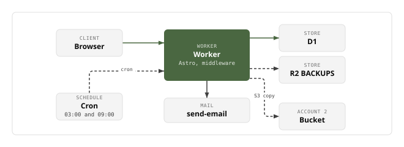
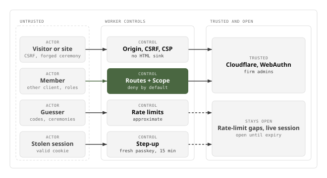
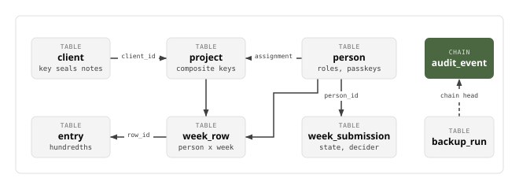
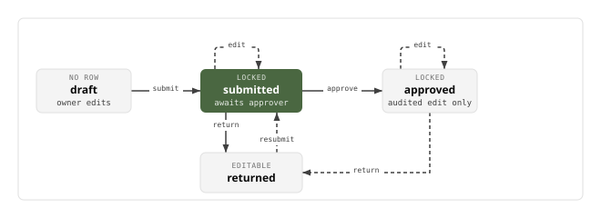

# Architecture

The one design document. Decisions costly to reverse are in `adr/`; everything else is code and tests. Change a boundary, flow or limit here, in the same commit.

## 1. Purpose and Never

Weekly timesheet for a professional-services firm: one Cloudflare deployment per firm, run by that firm, AGPL, version 0. The Never list is in `README.md` and is permanent (ADR 0002).

## 2. Shape



One Worker serves pages (Astro, server-rendered, Actions for forms) and the cron handlers. The week grid is the only React island and works as a plain form without script (ADR 0001, 0011). State is one D1 database plus one R2 bucket. Mail leaves through the send-email binding.

## 3. Trust boundaries and threats



Trusted: Cloudflare (Workers, D1, R2, Cron, their encryption at rest), the browser's WebAuthn, and the firm's admins, who are the root of trust for people, roles and reference data. Everyone else and every input is untrusted. Security tests are titled `SEC-nn ...` and each has a negative case.

- Visitor or other site: forged ceremonies, guessed codes, CSRF, injected script. Closed by origin check, rate limits, strict CSP, no HTML sink; open: rate limit is approximate (ADR 0003, 0007). `/setup` on an unconfigured, empty instance shows binding names only; keys are made in the browser and never sent. Once it is configured and still empty, `/setup` can create the first admin once: the form needs `SETUP_TOKEN` (compared in constant time), counts against the login bucket and writes only into an empty database.
- Signed-in member: cross-client reads, role escalation, writes to a locked week. Closed by the routes table and `Scope` (ADR 0004, 0005, 0009).
- Stolen session: step-up (a fresh passkey or provider confirmation, 15 minutes) gates high-impact routes; the rest stays open until the session ends.
- Database reader: sees names, emails and hours in the clear, never notes or stored tokens (hashed, sealed).
- Database writer: audit triggers and the chain catch edits unless the writer recomputes the chain (ADR 0006).
- Backup holder: sees nothing without the offline age identity and `NOTE_KEK` (ADR 0008).
- Demo visitor: the shared demo password is the demo's only extra credential, and the four signals keep it out of every other deploy (ADR 0003).

## 4. Request path


Every response, assets included, passes `headers.ts`. Middleware order is errors, session, CSRF, routes table (`src/routes.ts`: path, method, role, step-up; unlisted means denied). `/setup` skips session and CSRF only while the env does not parse: its gate (`src/middleware/setup.ts`) checks its row and renders only on an empty database. Once the env parses it is a 404 unless the database is empty, and then it runs the full chain like every other form. An Action gets a `Scope` and only reads or writes rows through it. A mutation and its audit event share one D1 batch. Errors come from the catalog in `src/lib/errors.ts` and log only class and code (ADR 0004, 0007).

## 5. Data



One D1 database, STRICT tables, hand-written SQL under `src/db/`, forward-only migrations. Hours are integer hundredths. Client rows carry `client_id` in composite keys. `audit_event` is append-only and hash-chained, its head recorded by each backup. Notes are sealed under a per-client key wrapped by `NOTE_KEK` (ADR 0005, 0006).

## 6. Week lifecycle



A week with no row is a draft. The dashed loops are the audited admin edit. Submit locks it to its owner; an approver returns or approves it. Only an accounting admin edits through the lock, with step-up, and each edit is audited (ADR 0009).

## 7. Backup and restore

03:00 UTC: dump every kept table as NDJSON, gzip, age-encrypt to the offline public key, write to R2, copy to a bucket in a second account over the S3 API; the night is ok only when both land. 09:00: the check verifies freshness, the chain against the last head, size headroom and the copy, and emails `alert_to`. `/healthz` is 503 until a good run exists and past the age limit. `just restore` and the restore drill share the dump's core code (ADR 0008, 0010).

## 8. Boundaries enforced by gates

| Rule                                                                                                                                           | Gate                                                           |
| ---------------------------------------------------------------------------------------------------------------------------------------------- | -------------------------------------------------------------- |
| SQL only under `src/db/`                                                                                                                       | `just lint` (`guard/sql-boundary`)                             |
| `src/db`, `src/auth`, `src/backup`, `src/lib` import no `astro:`, `cloudflare:` or edge directory                                              | `just lint` (`guard/import-gate`)                              |
| Roles only in `src/routes.ts` and `src/db/`                                                                                                    | `just lint` (`guard/role-boundary`)                            |
| Test support, `systemScope` and `test/` never reach shipped source                                                                             | `just lint` (`guard/test-support-gate`, `guard/test-boundary`) |
| A shipped migration never changes                                                                                                              | `just guard`                                                   |
| Hours are integer hundredths                                                                                                                   | tests (`src/actions/entries.app.test.ts`)                      |
| The audit log is append-only                                                                                                                   | `src/db/audit.test.ts`                                         |
| Client rows are read through a `Scope`, and `requireAll` refuses a non-all scope                                                               | `src/db/scope-kind.test.ts`                                    |
| Migrations only move forward                                                                                                                   | the migration gate (`just guard`)                              |
| Security tests are `SEC-nn`, each with a negative case                                                                                         | review                                                         |
| Errors only from `src/lib/errors.ts`; bindings read only in `src/lib/env.ts` and the field parsers it calls (`env-fields.ts`, `sso-config.ts`) | review; grep                                                   |
| Colours only as tokens in `src/styles/global.css`, contrast checked                                                                            | `just guard`                                                   |
| Source files <= 250 lines                                                                                                                      | `just guard`                                                   |
| Markdown only in README, CONTRIBUTING, AGENTS, ARCHITECTURE, ADRs, the PR template                                                             | `just guard`                                                   |
| Exact dependency pins; a new runtime dependency needs an ADR (0012)                                                                            | `SEC-27 (src/lib/dependencies.test.ts)`; review                |
| Files the scripts import use relative `.ts` imports, no `cloudflare:` or `astro:` modules                                                      | comment in `src/backup/export.ts`, restore drill               |
| Adopter specifics (domain, names, mapping, alert address) live in `wrangler.jsonc`, settings or seed, never in code                            | review                                                         |

## 9. Deploy

Recipes carry the order: `deploy-init`, edit `wrangler.jsonc`, `deploy-keys`, `deploy`, `deploy-secrets`, `deploy-check`, `first-admin` (`env` is empty, or `demo` for the demo). What a recipe cannot do:

- A Cloudflare account on the Workers Paid plan for the Worker, and a second account for backups, with its own bucket and an R2 token scoped to that one bucket. The lock rule is required: a first-account takeover can otherwise overwrite the off-account copy. Lock for 35 days and expire at 40, so the lock always ends first. In the second account (`wrangler login` as it, or its API token), with `<bucket>` the bucket name:
  ```sh
  npx wrangler r2 bucket create <bucket>
  npx wrangler r2 bucket lock add <bucket> keep-35d "" --retention-days 35
  npx wrangler r2 bucket lifecycle add <bucket> expire-40d "" --expire-days 40
  npx wrangler r2 bucket lock list <bucket>
  npx wrangler r2 bucket lifecycle list <bucket>
  ```
  In the dashboard, create the token as Object Read & Write on that bucket only, never account-wide. Then put the four values, one per line (endpoint, bucket, key id, secret), in a file outside the repo and run `just offsite-check < <file>`; it probes the bucket with the Worker's key: it must write, must not overwrite or delete, and must not list the account. It leaves one small object under `offsite-check/` that the expiry removes. It does not read the expiry, so check the two `list` lines show 35 and 40 days.
- A domain. Set `ORIGIN`, `RP_ID`, `MAIL_FROM` and the route in `wrangler.jsonc`; the D1 database is found by name, so there is no `database_id` to copy. Leave `BACKUP_COPY` and `BACKUP_S3_REGION`.
- The Deploy to Cloudflare button: see "With the button" below. It leaves the 35-day expiry and the second-account copy to you.
- Name an owner for the offline kit (age identity, `NOTE_KEK`, `SESSION_SECRET`, the domain); losing `NOTE_KEK` loses every note. Copy it out of `.wrangler/kit` and read it back before any data exists.
- `deploy-secrets` takes the four `BACKUP_S3_*` values on standard input.
- Single sign-on is optional and off until `SSO_PROVIDERS` is set: a JSON array (as a string, or as an array in `wrangler.jsonc`), one entry per provider tenant, `{"id","label","issuer","client_id"}` (`hd` limits Google to one Workspace domain; the Google preset is `{"id":"google","client_id":"..."}`). Each needs `wrangler secret put SSO_SECRET_<ID>` (id upper-cased, `-` as `_`). At the provider, register an app, add the redirect URI `<ORIGIN>/auth/sso/callback`, and use its tenant v2.0 issuer URL (Entra ID: the tenant's `https://<host>/<tenant-id>/v2.0`, never `/common`); a multi-tenant endpoint fails the exact issuer match. Diarise each secret's expiry. People are linked by an enrolment link; an admin unlinks at `/admin/people/<id>`. Deploy-to-Cloudflare leaves it off.
- The demo is the Worker `tidwick-demo`. Before its first CI deploy run `just deploy-secrets demo`, and move `demo.tidwick.dev` off any older `tidwick` Worker.
- Demo only: `/demo` signs in as one of four seeded personas with a shared `DEMO_PASSWORD` secret (set it with `wrangler secret put`; 16 or more characters), for two hours and with no passkey prompt. It answers only while `DEMO_LOGIN` and `DEMO_BANNER` are `on`, the password is set and the seed's `demo` setting exists, otherwise 404. A 04:00 cron wipes the database and loads the seed again; `just demo-reset remote` still applies schema changes (ADR 0003).
- After the first admin enrols: delete `SETUP_TOKEN` if set; set alert address, age limit, time zone at `/admin/settings`; confirm the first backup in both buckets; rehearse a restore.

### With the button

The button clones `main`, so it deploys the last release. It builds on Node from `.node-version` and runs `npm run deploy` (remote migrations by binding `DB`, then `wrangler deploy`); the Worker answers on workers.dev.

1. Press the button, accept the names, let the build finish.
2. Open `/setup`. Until the secrets exist every route fails closed; on an empty database `/setup` lists what is missing, and with any history it shows the same error.
3. Generate `SESSION_SECRET`, `NOTE_KEK` and the age key on `/setup` (nothing is sent) and keep the kit offline.
4. Set `SESSION_SECRET`, `NOTE_KEK`, `BACKUP_RECIPIENT` and `SETUP_TOKEN` under Settings, Variables and Secrets (the kit file from `/setup` holds all four, and the age identity). Set `RP_ID` in `wrangler.jsonc` to the host of `ORIGIN` or a parent of it; `/setup` keeps the claim closed until it is.
5. The off-account copy: `BACKUP_COPY` is `s3`, so also set `BACKUP_S3_ENDPOINT`, `BACKUP_S3_BUCKET`, `BACKUP_S3_KEY_ID` and `BACKUP_S3_SECRET` (the button's form leaves them empty), or the nightly backup fails and `/healthz` answers 503. An instance that opts out sets `BACKUP_COPY` to `none` in `wrangler.jsonc` and keeps only the in-account copy.
6. Reload `/setup`, claim the first admin with the token, enrol a passkey. A lost link: the same form with the same email issues a new one while that admin has no passkey and no linked identity; once either exists it does nothing. A re-issue revokes that admin's sessions, unused recovery codes and other open links, so anyone holding `SETUP_TOKEN` and the admin's email can displace an admin who has not finished enrolling; delete `SETUP_TOKEN` as soon as you have enrolled.
7. Delete `SETUP_TOKEN`. Add the 35-day expiry to `tidwick-backups`; `/setup` repeats the command.
8. Update by a documented merge from a release tag: in the clone, `git pull https://github.com/tidwick/tidwick vX.Y.Z && git push`; the build migrates and deploys.

Lab checklist, run by hand each release, on a fresh account. Order: merge the release PR to `next`, fast-forward `main` (`git push origin origin/next:main`), run the lab, then tag. The button clones `main`, so the lab only sees the release after the fast-forward:

- Real button from the README, build green.
- `/setup` lists the missing values; claim the first admin.
- Passkey enrolled and used on a phone.
- Use it for a week: submit, approve, lock.
- Export the CSV and open it.
- MCP `tools/list` answers with a token.
- `/healthz` is 200 the next day, after the 03:00 backup.
- Restore drill: `just restore` a real backup into a local D1.

## 10. Operate

- `NOTE_KEK` rotation: set `NOTE_KEK_PREVIOUS` to the old value, then `NOTE_KEK` to the new, press "Re-wrap keys" until done, delete PREVIOUS. Keep the retired value until the last pre-rotation backup has expired (40 days).
- `SESSION_SECRET` rotation ends every session, recovery code, open enrolment link and lockout counter; passkeys and linked identities survive.
- Keep each age identity as long as the oldest backup it encrypts; rehearse a restore after any `BACKUP_RECIPIENT` change, since a wrong recipient is undetectable in the Worker.
- Backups are kept by bucket lifecycle only (ADR 0008). The Worker deletes none.
- Lost first enrolment link, `SETUP_TOKEN` still set: the `/setup` form. Otherwise, no admin can sign in. Read the live audit head and the admin ids (a backup's header head is stale and the rescue then writes nothing):
  ```sh
  npx wrangler d1 execute tidwick --remote --command "SELECT seq, hash FROM audit_event ORDER BY seq DESC LIMIT 1"
  npx wrangler d1 execute tidwick --remote --command "SELECT person_id FROM person_role WHERE role = 'admin'"
  ```
  Then `just rescue <person id> <seq> <hash>` with the deployed `SESSION_SECRET` on standard input, and run the two commands it prints: apply the file, then the check, which answers `landed` or `no-op`. A no-op means the head moved or an admin can still sign in. For the only admin who lost every device but whose passkeys are still on file, add `.wrangler/rescue.sql --revoke-passkeys` after the hash: it revokes that person's passkeys as well, audited as `people.rescue`, and still writes nothing while another admin holds a passkey.
- Offboarding revokes sessions, passkeys, linked identities and codes and is audited.
- Migrations only move forward. Update as in step 8 of §9; your `wrangler.jsonc` edits merge with the release there. v0.1.0 squashed the first eleven migrations into `0001_init.sql`; an instance deployed from `main` before it deploys the last `next` commit before the squash once (it then holds all eleven), runs `wrangler d1 execute DB --remote --command "INSERT INTO d1_migrations (name) VALUES ('0001_init.sql')"` to mark the squash applied (same schema), then deploys the release. A backup taken under `0011_sso.sql` is refused by restore; take a new one.
- `just backup-size` runs the size estimate against the live D1. Past 70% of the backup cap (`BACKUP_WARN_PERCENT` in `src/lib/limits.ts`, the same line the 09:00 check warns at), plan the streaming backup.

### Restore

A lost or corrupted production D1, in order. Check out the release whose last migration the backup header names (`restore` says which). Never run this against a database that holds rows.

1. If the database still exists but its data is wrong, try D1 Time Travel first: `npx wrangler d1 time-travel info tidwick`, then `restore tidwick --timestamp <time just before the damage>`. It rewinds in place within the plan's retention window, and it belongs to the database, so a deleted database takes it along. The audit log rewinds with the rows, so the chain stays whole.
2. Fetch the newest good night: `just backup-fetch YYYY-MM-DD` from the Worker account's R2, or from the off-account bucket with any S3 client, for example `aws s3 cp --endpoint-url <endpoint> s3://<bucket>/backups/YYYY/MM/DD.ndjson.gz.age .wrangler/restore-remote/backup.age` with the off-account key as `AWS_ACCESS_KEY_ID` and `AWS_SECRET_ACCESS_KEY`.
3. Create the empty database: `npx wrangler d1 create tidwick` (the Worker finds it by name; delete the lost one first).
4. `just restore-remote .wrangler/restore-remote/backup.age <age identity from the offline kit>` checks the header, schema version and audit chain, migrates the new database and loads the rows, and refuses a database that holds any. Delete `.wrangler/restore-remote/restore.sql`, which holds every row in the clear.
5. `just deploy-secrets` with the same offline kit (`NOTE_KEK` must be the original, or every note stays sealed), then `just deploy`, then `just deploy-check`.
6. Sessions, challenges and agent tokens were never backed up, so everyone signs in again. The restore brings back passkeys and open links as of the backup's time: offboard or re-enrol anyone who left or was re-enrolled since, and sign in as an admin to check `/healthz`.
7. Take a backup by hand or wait for 03:00, and confirm it lands in both buckets. Writes since the backup are gone; say so to the people who entered them.

The same steps against a throwaway database are what `just restore-drill` runs on every change, with hostile text in the seed and a per-table content digest. The walk on a real Cloudflare account has not been done: lab: pending. Its checklist: (a) `backup-fetch` from R2, (b) the S3 fetch from the off-account bucket, (c) `d1 create`, `restore-remote`, deploy, sign in, (d) `rescue` and `rescue --revoke-passkeys` landed and no-op on the live head, (e) `offsite-check` passes and `lifecycle list` shows 40 days, (f) `time-travel restore` on a copy, and whether Time Travel survives deleting a database, (g) `backup-size` prints a percentage.

Leaving Cloudflare: a backup is age-encrypted NDJSON, one line per row. `just restore` decrypts it and rebuilds a SQLite database, the same path the restore drill in `just check` exercises on every change. Keep the age identity, export the CSV too, and run the Worker, or any SQLite reader, elsewhere.

## 11. Known limits

Numbers live in code; see the cited ADR.

- Client erasure is not built; notes cannot be shredded. `client.erased_at` and `client_key.destroyed_at` are reserved; nothing writes them.
- Enrolment links are shown once to the issuing admin, never emailed. `addPasskeyVerify` revokes no other passkey.
- `NOTE_KEK` rotation re-wraps client keys, it does not re-key notes: an old KEK plus an old read still opens them. It lives in the same account as the data.
- Rate limiting is approximate, per location, per IPv4 or IPv6 /64. Anyone who knows an email can delay that person's recovery.
- Add-row lists every live project to an admin or accounting admin; picking one assigns them through the audited assignment write. A member sees only assigned projects.
- Single sign-on has no back-channel logout: disabling a person at the provider stops new sign-ins, and offboarding in tidwick ends their sessions. A provider that sends no `auth_time` cannot confirm a step-up: Entra ID needs the `auth_time` optional claim added to the ID token, and Google may not honour `prompt=login`, so an SSO-only person there may be unable to step up. A person who enrolled through a provider has no recovery codes until they make some on `/account`; until then an admin recovers them. At least one admin keeps a passkey, since an expired secret or provider outage must not lock the firm out.
- An accounting admin can approve their own week (audited). Roles are not per client. Step-up lasts 15 minutes and includes sign-in.
- Restoring revives access revoked after the backup was taken. A backup is encrypted, not authenticated.
- The chain check is beaten by a writer who recomputes it; keep a head off-database (backup header, `/healthz`).
- Export and backup are built in memory under caps (ADR 0010, 0008); the CSV formula escape assumes comma separators.
- The week edit view omits an edit that cleared a cell through the lock; the audit log has it.
- Workers invocation logs are off. The 09:00 alert needs `alert_to` and `MAIL` on.
- Clients, projects and task codes are archived, never deleted.
- A wrong mapping on import cannot be undone as a batch; correct cell by cell.
