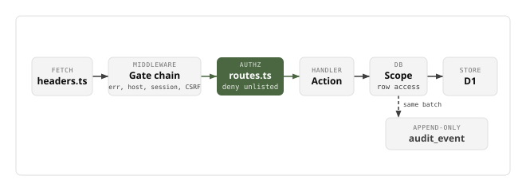

# Architecture

The one design document. Decisions costly to reverse are in `adr/`; everything else is code and tests. Change a boundary, flow or limit here, in the same commit.

## 1. Purpose and Never

Weekly timesheet for a professional-services firm: one Cloudflare deployment per firm, run by that firm, AGPL, version 0. The Never list is in `README.md` and is permanent (ADR 0002).

## 2. Shape

One Worker serves pages (Astro, server-rendered, Actions for forms) and the cron handlers. The week grid is the only React island and works as a plain form without script (ADR 0001, 0011). State is one D1 database plus one R2 bucket. Mail leaves through the send-email binding.

## 3. Trust boundaries and threats

Trusted: Cloudflare (Workers, D1, R2, Cron, their encryption at rest), the browser's WebAuthn, and the firm's admins, who are the root of trust for people, roles and reference data. Everyone else and every input is untrusted. Security tests are titled `SEC-nn ...` and each has a negative case.

- Visitor or other site: forged ceremonies, guessed codes, CSRF, injected script. Closed by origin check, rate limits, strict CSP, no HTML sink; open: rate limit is approximate (ADR 0003, 0007).
- Signed-in member: cross-client reads, role escalation, writes to a locked week. Closed by the routes table and `Scope` (ADR 0004, 0005, 0009).
- Stolen session: step-up (a fresh passkey confirmation, 15 minutes) gates high-impact routes; the rest stays open until the session ends.
- Database reader: sees names, emails and hours in the clear, never notes or stored tokens (hashed, sealed).
- Database writer: audit triggers and the chain catch edits unless the writer recomputes the chain (ADR 0006).
- Backup holder: sees nothing without the offline age identity and `NOTE_KEK` (ADR 0008).
- Demo visitor: the shared demo password is the demo's only extra credential, and the four signals keep it out of every other deploy (ADR 0003).

## 4. Request path

Every response, assets included, passes `headers.ts`. Middleware order is errors, session, CSRF, routes table (`src/routes.ts`: path, method, role, step-up; unlisted means denied). An Action gets a `Scope` and only reads or writes rows through it. A mutation and its audit event share one D1 batch. Errors come from the catalog in `src/lib/errors.ts` and log only class and code (ADR 0004, 0007).

## 5. Data

One D1 database, STRICT tables, hand-written SQL under `src/db/`, forward-only migrations. Hours are integer hundredths. Client rows carry `client_id` in composite keys. `audit_event` is append-only and hash-chained, its head recorded by each backup. Notes are sealed under a per-client key wrapped by `NOTE_KEK` (ADR 0005, 0006). Per-client erasure is not built: `erased_at` and `destroyed_at` on the key rows are reserved and nothing writes them.

## 6. Week lifecycle

A week with no row is a draft. The dashed loops are the audited admin edit. Submit locks it to its owner; an approver returns or approves it. Only an accounting admin edits through the lock, with step-up, and each edit is audited (ADR 0009).

## 7. Backup and restore

03:00 UTC: dump every kept table as NDJSON, gzip, age-encrypt to the offline public key, write to R2, copy to a bucket in a second account over the S3 API; the night is ok only when both land. 09:00: the check verifies freshness, the chain against the last head, size headroom and the copy, and emails `alert_to`. `/healthz` is 503 until a good run exists and past the age limit. `just restore` and the restore drill share the dump's core code (ADR 0008, 0010).

## 8. Boundaries enforced by gates

| Rule                                                                                                                | Gate                                             |
| ------------------------------------------------------------------------------------------------------------------- | ------------------------------------------------ |
| SQL only under `src/db/`                                                                                            | `just lint-sql-boundary`                         |
| Roles only in `src/routes.ts` and `src/db/`                                                                         | `just lint-role-boundary`                        |
| Errors only from `src/lib/errors.ts`; bindings read only in `src/lib/env.ts`                                        | review; grep                                     |
| Colours only as tokens in `src/styles/global.css`, contrast checked                                                 | `just colour-literals`, `just contrast`          |
| Source files <= 250 lines                                                                                           | `just size`                                      |
| Markdown only in README, CONTRIBUTING, AGENTS, ARCHITECTURE, ADRs, the PR template                                  | `just docs-bar`                                  |
| Exact dependency pins                                                                                               | `test/toolchain-pins.test.ts`                    |
| Files the scripts import use relative `.ts` imports, no `cloudflare:` or `astro:` modules                           | comment in `src/backup/export.ts`, restore drill |
| Adopter specifics (domain, names, mapping, alert address) live in `wrangler.jsonc`, settings or seed, never in code | review                                           |

## 9. Deploy

Recipes carry the order: `deploy-init`, edit `wrangler.jsonc`, `deploy-keys`, `deploy`, `deploy-secrets`, `deploy-check`, `first-admin` (`env` is empty, or `demo` for the demo). What a recipe cannot do:

- A Cloudflare account for the Worker, and a second account for backups, with its own bucket (a lock rule is required: a first-account takeover can otherwise overwrite the off-account copy; object lock shorter than its expiry, e.g. 35 days against 40) and an R2 token scoped to that one bucket.
- A domain. Set `ORIGIN`, `RP_ID`, `MAIL_FROM`, the D1 `database_id` and the route in `wrangler.jsonc`; leave `BACKUP_COPY` and `BACKUP_S3_REGION`.
- Name an owner for the offline kit (age identity, `NOTE_KEK`, `SESSION_SECRET`, the domain). Copy it out of `.wrangler/kit` and read it back before any data exists.
- `deploy-secrets` takes the four `BACKUP_S3_*` values on standard input.
- The demo is the Worker `tidwick-demo`. Before its first CI deploy run `just deploy-secrets demo`, and move `demo.tidwick.dev` off any older `tidwick` Worker.
- Demo only: `/demo` signs in as one of four seeded personas with a shared `DEMO_PASSWORD` secret (set it with `wrangler secret put`; 16 or more characters), for two hours and with no passkey prompt. It answers only while `DEMO_LOGIN` and `DEMO_BANNER` are `on`, the password is set and the seed's `demo` setting exists, otherwise 404. A 04:00 cron wipes the database and loads the seed again; `just demo-reset remote` still applies schema changes (ADR 0003).
- After the first admin enrols: set alert address, age limit, time zone at `/admin/settings`; confirm the first backup in both buckets; rehearse a restore.

## 10. Operate

- `NOTE_KEK` rotation: set `NOTE_KEK_PREVIOUS` to the old value, then `NOTE_KEK` to the new, press "Re-wrap keys" until done, delete PREVIOUS. Keep the retired value until the last pre-rotation backup has expired (40 days).
- `SESSION_SECRET` rotation ends every session, recovery code, open enrolment link and lockout counter; passkeys survive.
- Keep each age identity as long as the oldest backup it encrypts; rehearse a restore after any `BACKUP_RECIPIENT` change, since a wrong recipient is undetectable in the Worker.
- Backups are kept by bucket lifecycle only (35 days; 40 off-account). The Worker deletes none.
- No admin can sign in: `just rescue` with the audit head from `/healthz` or a backup header, and the deployed `SESSION_SECRET`.
- Offboarding revokes sessions, passkeys and codes and is audited.
- Migrations only move forward. Redeploy by merging your `wrangler.jsonc` edits into the new release.
- Past 60% of the backup cap (`ESTIMATE_SQL` in `src/db/backup-estimate.ts`), plan the streaming backup.

## 11. Known limits

Numbers live in code; see the cited ADR.

- Client erasure is not built; notes cannot be shredded.
- Enrolment links are shown once to the issuing admin, never emailed. `addPasskeyVerify` revokes no other passkey.
- `NOTE_KEK` rotation re-wraps client keys, it does not re-key notes: an old KEK plus an old read still opens them. It lives in the same account as the data.
- Rate limiting is approximate, per location, per IPv4 or IPv6 /64. Anyone who knows an email can delay that person's recovery.
- Add-row lists every live project to an admin or accounting admin; picking one assigns them through the audited assignment write. A member sees only assigned projects.
- An accounting admin can approve their own week (audited). Roles are not per client. Step-up lasts 15 minutes and includes sign-in.
- Restoring revives access revoked after the backup was taken. A backup is encrypted, not authenticated.
- The chain check is beaten by a writer who recomputes it; keep a head off-database (backup header, `/healthz`).
- Export and backup are built in memory under caps (ADR 0010, 0008); the CSV formula escape assumes comma separators.
- The week edit view omits an edit that cleared a cell through the lock; the audit log has it.
- Workers invocation logs are off. The 09:00 alert needs `alert_to` and `MAIL` on.
- Clients, projects and task codes are archived, never deleted.
- A wrong mapping on import cannot be undone as a batch; correct cell by cell.
